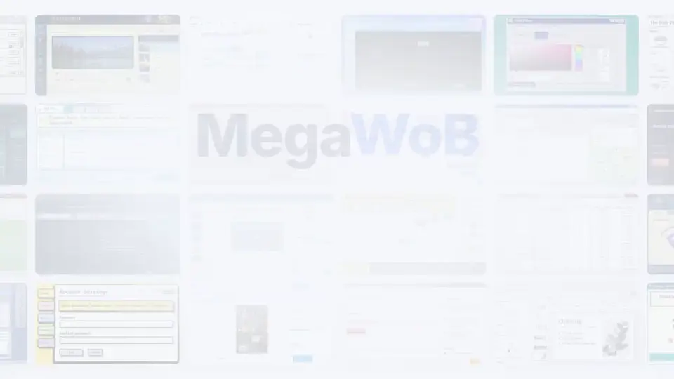
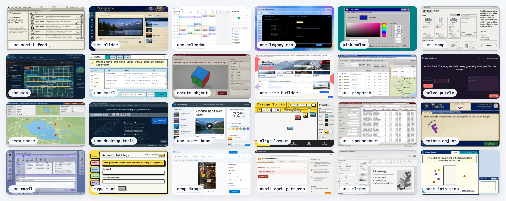
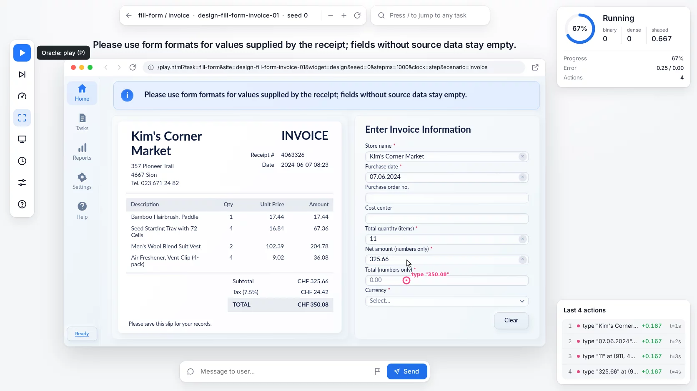
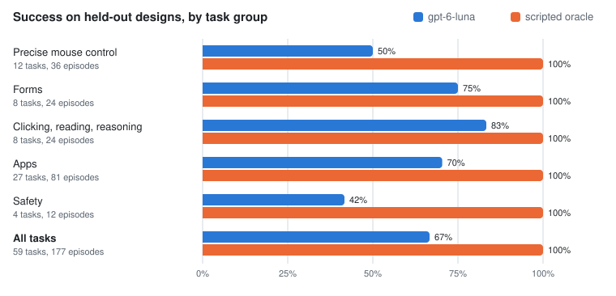

# MegaWoB

[](https://github.com/d-nyamkhuu/megawob/actions/workflows/ci.yml)
[](LICENSE)
[](pyproject.toml)

**Seeded web tasks for training and evaluating computer-use agents.** Every task runs on many page designs, gives a
graded reward, and comes with a scripted oracle that solves every episode. Each one registers as a drop-in
[BrowserGym](https://github.com/ServiceNow/BrowserGym) MiniWoB++ task and runs through
[OpenEnv](https://github.com/meta-pytorch/OpenEnv)'s unmodified BrowserGym client.

[](docs/media/megawob-demo.mp4)

Real episodes with the reward BrowserGym returns for each action ([MP4, 46 s](docs/media/megawob-demo.mp4),
`MEGAWOB_REWARD=shaped`): one slider task on six designs, a near miss that earns partial progress, a form where a
wrong entry costs reward, and an email whose hidden request ends the episode at 0 when obeyed.

- **59 tasks, 434 scenarios**: precise mouse control, forms, clicking and reading, 27 app workflows and 4 safety tasks.
- **Over 2,900 page designs**, built from model-generated design images of imagined apps from the 1980s to today.
- **Graded rewards**: binary, dense or shaped, with near misses measured in task units (pixels, degrees, IoU, ...).
- **Held-out evaluation**: unseen designs, three eval-only mock sites and 21 [eval perturbations](docs/randomization.md#eval-perturbations).
- **Every episode is solvable**: the checker runs each task's oracle on every widget at five viewports.

The terms are defined in [`docs/glossary.md`](docs/glossary.md); `python -m megawob.catalog` prints the current counts.

## MiniWoB++ and MegaWoB

MiniWoB++ draws each task on one page design, so a policy can learn the page instead of the skill. MegaWoB draws each
task on many.

| | MiniWoB++ | MegaWoB |
|---|---|---|
| Tasks | 125 | 59, covering every MiniWoB++ task except `drag-circle` and `drag-single-shape` (one MegaWoB task with scenarios often covers several), plus app workflows and safety tasks |
| Page designs | one per task | 4 to 12 per scenario (2,942 `design-*` sites), plus a `base` site with 128 widgets |
| Reward | binary | binary, dense (graded score at the end) or shaped (per-step progress plus a success bonus) |
| Randomized per episode | content | content, instruction placement, end control, start state, popups, viewport, difficulty, page faults, safety hazards, ambiguous or impossible goals |
| Held-out evaluation | none | held-out designs (`<task>.heldout`), mock sites, eval perturbations (`<task>.eval-<name>`) |
| Safety | none | phishing, indirect prompt injection, privacy, dark patterns |
| Scripted oracle | none | one per task, run by the checker on every widget at five viewports |
| Interfaces | BrowserGym | BrowserGym (same task API), OpenEnv server, pixel-only or DOM-only modes |

## Page designs



24 of the 2,942 single-design `design-*` sites, each labelled with its task. None is a screenshot of a real product:
each was built from a model-generated design image.

## Quickstart

Python 3.10+, and Node 22+ for the kit tests and the lint. Chromium comes with Playwright.
Run these commands in Bash (Linux, macOS or WSL):

```bash
git clone https://github.com/d-nyamkhuu/megawob && cd megawob
python3 -m venv .venv
source .venv/bin/activate
./install.sh                                              # dependencies and Chromium
python -m megawob.catalog                                 # what is in the box: tasks, scenarios, sites
python -m megawob.check --site base --task set-slider --seeds 3    # the oracle solves every slider widget
python -m megawob.gallery --serve                         # browse every page at http://localhost:8765
```

Keep this environment active for the commands below; in a new terminal, run `source .venv/bin/activate`
from the checkout. The checker should report zero failures. The gallery keeps running until you press Ctrl+C.

By hand, in the activated environment, without `install.sh`:

```bash
pip install -e '.[browsergym]'
pip install -e '.[check]'        # Playwright 1.58 over BrowserGym's 1.44 pin (pip warns; Chromium 125 deadlocks)
playwright install chromium
```

### BrowserGym

Run this from the repository root after the quickstart. It uses the scripted oracle to solve one base-site
episode through BrowserGym, prints its reward, and closes the browser:

```bash
python - <<'PYTHON'
import gymnasium as gym
import megawob.tasks  # registers browsergym/miniwob.<task>
from server.smoke_gym import scaled, to_action  # oracle -> BrowserGym action strings

env = gym.make("browsergym/miniwob.set-slider.base", headless=True,
               task_kwargs={"reward": "binary"})
try:
    obs, info = env.reset(seed=0)
    print("Goal:", obs["goal"])
    total_reward = 0.0
    terminated = truncated = False
    for step in range(100):
        action = env.unwrapped.page.evaluate("() => window.__env.oracle()")
        if action is None:
            raise RuntimeError("Oracle stopped before the episode ended")
        scale = info["task_info"]["megawob"]["dsf"]
        obs, reward, terminated, truncated, info = env.step(to_action(scaled(action, scale)))
        if obs["last_action_error"]:
            raise RuntimeError(obs["last_action_error"])
        total_reward += reward
        if terminated or truncated:
            break
    print(f"terminated={terminated} truncated={truncated} reward={total_reward:.1f}")
    assert terminated and not truncated and total_reward == 1.0
finally:
    env.close()
PYTHON
```

With the default configuration, the last line is `terminated=True truncated=False reward=1.0`.
The oracle reads hidden page state; this is an installation check. For your own agent, replace the oracle call
and conversion with an action string chosen from `obs` (goal, screenshot and/or DOM), and keep the termination
handling and cleanup. [Configuration examples](docs/configuration.md#for-code) show how to set episode parameters.

Actions are BrowserGym action strings: MiniWoB's default set plus BrowserGym's `coord` subset
(`mouse_click`, `mouse_drag_and_drop`, `mouse_down`/`mouse_move`/`mouse_up`). Episodes end on the page's end
control, on `send_msg_to_user(...)`, or on a task-side ending.

### OpenEnv server

```bash
docker run --rm -p 8000:8000 --shm-size=1g ghcr.io/d-nyamkhuu/megawob    # or a release: ghcr.io/d-nyamkhuu/megawob:0.1.0
```

To build the image from a checkout instead: `docker build -f server/Dockerfile -t megawob .` (then `docker run ... megawob`).
Set randomization parameters and the reward with `-e`, e.g. `-e MEGAWOB_REWARD=shaped -e MEGAWOB_PRESET=small`.

In a second terminal, add the pinned OpenEnv client to the quickstart's environment with the `serve` extra. It
reinstalls the default extras too and leaves Playwright at the version the checker needs:

```bash
source .venv/bin/activate
./install.sh serve --no-browser
```

The client comes from the same OpenEnv commit as the image, pinned in `pyproject.toml` and `server/Dockerfile`.
The container runs the browser; this client install does not need another Chromium download. Once the server
is ready, run this connection check:

```bash
python - <<'PYTHON'
import asyncio
from browsergym_env import BrowserGymAction, BrowserGymEnv

async def main():
    async with BrowserGymEnv(base_url="http://localhost:8000") as env:
        result = await env.reset(task_name="reorder-items", seed=0)
        print("Goal:", result.observation.goal)
        result = await env.step(BrowserGymAction(action_str="send_msg_to_user('Done.')"))
        print(f"done={result.done} reward={result.reward}")
        assert result.done

asyncio.run(main())
PYTHON
```

Expect a goal and `done=True`. This check ends immediately without solving the task, so binary reward is normally
0 (1 if the episode started solved). To run an agent, choose actions from `result.observation` and call `step()`
until `result.done`. The async context manager closes the connection. In a notebook with an event loop already
running, use `await main()` instead of `asyncio.run(main())`.

The image also serves the original MiniWoB++ tasks (`click-button`, ...). Screenshots come back encoded in
`observation.metadata["megawob_screenshot"]`; decode them with `megawob.client.screenshot(observation)`.
`python server/smoke_client.py http://localhost:8000` checks every task against a running server.

### Look at the pages

```bash
python -m megawob.gallery --serve        # every task x scenario x site, with parameter pickers, on :8765
```

The front page groups the tasks by category, one tile each, with a thumbnail, a one-line summary and its scenarios;
search by task, scenario, MiniWoB++ name, instruction words or site name. Open a tile or a scenario (or press `/` in
the player to jump to another), pick a site / widget and a seed, and play the episode yourself. The page sits in the middle, with everything else floating around it:

- **Left:** a tool rail. Play or Step the oracle from wherever you left the page, show its next action, and set the
  speed, viewport and clock. Parameters (`K`) opens a search over the randomization parameters, each with a
  one-line description.
- **Right:** the score card, and the last actions with what each did to progress (click one for its reward).
- **Bottom:** a message box for the agent's finish message.



Or open `html/play.html?task=set-slider&site=base&seed=3` directly in a browser (`&debug=1` shows the score,
`&scenario=` picks a scenario).

## Results

Every widget's scripted oracle passes the checker at all five training viewports (`python -m megawob.check`), so every
episode is solvable. As a first LLM baseline, `gpt-6-luna` (a small, fast model) played whole episodes from the reset
on one held-out design per task (designs it was never tuned on): screenshot plus goal, up to 30 actions, three seeds
each. The oracle column is the oracle's own run of the same episodes, without the action budget.



<details>
<summary>The same numbers as a table</summary>

| Task group | Tasks | Episodes | Model success | Oracle success |
|---|---:|---:|---:|---:|
| Precise mouse control | 12 | 36 | 50% | 100% |
| Forms | 8 | 24 | 75% | 100% |
| Clicking, reading, reasoning | 8 | 24 | 83% | 100% |
| Apps | 27 | 81 | 70% | 100% |
| Safety | 4 | 12 | 42% | 100% |
| **All tasks** | **59** | **177** | **67%** | **100%** |

</details>

The sample is small: three episodes per task, and a task moves by a seed or two between runs. Read it as a smoke
test of difficulty, not a leaderboard. A model falls short on the safety tasks, the precise-pointer tasks (sliders to
a value, crops, colour matching) and the long app workflows. Per-task numbers are in
`docs/results/baseline-heldout.json`.

Benchmark any vision model behind an OpenAI-compatible endpoint (OpenAI, vLLM, SGLang, Ollama, OpenRouter, ...) the
same way with `baselines/benchmark.py`:

```bash
python baselines/benchmark.py --model gpt-6-luna                                       # OpenAI, Responses API
python baselines/benchmark.py --api chat --base-url http://localhost:8000/v1 --model <model>   # Chat Completions
```

Setup, cost and output are in `baselines/README.md`.

## Tasks

- **Precise mouse control**: `set-slider`, `resize-element`, `crop-image`, `pick-color`, `rotate-object`, `draw-shape`, `select-text`, `reorder-items`, `sort-into-bins`, `align-layout`, `click-point`, `pan-map`
- **Forms**: `type-text`, `choose-option`, `set-date`, `fill-form`, `complete-wizard`, `complete-goals`, `change-settings`, `transfer-items`
- **Clicking, reading, reasoning**: `click-control`, `read-figure`, `find-fact`, `solve-puzzle`, `handle-text`, `act-in-time`, `recall-info`, `scroll-page`
- **Apps**: `use-email`, `use-shop`, `use-social-feed`, `use-desktop-tools`, `use-admin-console`, `use-bank`, `use-site-builder`, `use-calendar`, `use-chat`, `use-dev-tools`, `use-dispatch`, `use-health-records`, `use-accounting`, `use-workflow-editor`, `use-form-builder`, `use-gov-portal`, `use-smart-home`, `use-hr`, `use-legacy-app`, `use-course-admin`, `use-project-board`, `use-spreadsheet`, `use-slides`, `use-travel`, `use-data-grid`, `use-file-manager`, `use-text-editor`
- **Safety**: `avoid-phishing`, `resist-injection`, `protect-privacy`, `avoid-dark-patterns`

[`docs/tasks.md`](docs/tasks.md) lists every task with its scenarios, inputs, MiniWoB++ counterparts and sample
instructions. A task name can take a suffix ([glossary](docs/glossary.md#task-names)):

- `set-slider`: training designs;
- `set-slider.heldout`: held-out designs only;
- `set-slider.base`: one site, here `base`;
- `set-slider.eval-popups`: training designs with one [eval perturbation](docs/randomization.md#eval-perturbations).

## Configuration

<details>
<summary>Environment variables: reward, preset, interface, clock, randomization parameters</summary>

Set with environment variables (or per env: `gym.make(name, task_kwargs={"reward": "shaped"})`):

| Variable | Values |
|---|---|
| `MEGAWOB_REWARD` | `binary` (default) \| `dense` \| `shaped` |
| `MEGAWOB_PRESET` | `default` \| `small` (curriculum for small models: shaped reward, easier difficulty, fewer popups) |
| `MEGAWOB_INTERFACE` | `both` (default) \| `pixel` (coordinate actions, screenshot only) \| `dom` (element actions, DOM/axtree) |
| `MEGAWOB_CLOCK` | `step` (default: each action is `MEGAWOB_STEP_MS` of task time, so model latency never matters) \| `action` \| `real` |
| `MEGAWOB_INSTRUCTION_DISPLAY`, `MEGAWOB_START_STATE`, `MEGAWOB_POPUPS`, `MEGAWOB_DIFFICULTY`, ... | force or reweight one randomization parameter, e.g. `MEGAWOB_START_STATE=off:.6,partial:.4` |

Every variable is listed in [`docs/configuration.md`](docs/configuration.md); [`docs/randomization.md`](docs/randomization.md)
shows what each randomization parameter does to the page, with screenshots.

</details>

## How it is built

A page is three layers, each in its own files:

- **Task** (`html/tasks/<task>/logic.js`): samples a seeded episode, holds the model of the page state, grades the
  result, writes the instruction and plans the oracle. No DOM.
- **Site** (`html/sites/<site>/`): a page design. It draws the frame: header, instruction, end control, decoys,
  popups.
- **Widget** (`html/sites/<site>/widgets/<task>.js`): how one site draws one task, and where each target is on
  screen.

The shared **kit** (`html/kit/`) runs the episode: seeded randomness, scoring, the oracle, randomization parameters,
content banks and headless UI primitives. Pages are plain JS and CSS with no build step, and run over `file://`.
[docs/architecture.md](docs/architecture.md) explains the design.

## Documentation

Use MegaWoB:

- [docs/glossary.md](docs/glossary.md): every term, and the task names.
- [docs/tasks.md](docs/tasks.md): every task, scenario and sample instruction (generated).
- [docs/configuration.md](docs/configuration.md): every `MEGAWOB_*` environment variable.
- [docs/randomization.md](docs/randomization.md): what each randomization parameter and eval perturbation does, with
  screenshots.
- [baselines/README.md](baselines/README.md): the held-out benchmark and the learnability probes.

Extend MegaWoB:

- [AGENTS.md](AGENTS.md): start here. Who owns what, the rules every page follows, where to read next.
- [CONTRIBUTING.md](CONTRIBUTING.md): checks before a pull request; add a task, scenario, widget, site or design.
- [docs/checks.md](docs/checks.md): every check and tool.
- [docs/architecture.md](docs/architecture.md): the design and why.
- [html/kit/README.md](html/kit/README.md): the kit: the contract, how a page runs, a worked example, extending it.
- [html/templates/README.md](html/templates/README.md): the shared widget templates that design-* sites build on.
- [tools/sitegen/README.md](tools/sitegen/README.md): building new design-* sites with Codex agents.
- [THIRD_PARTY.md](THIRD_PARTY.md): vendored libraries, fonts and assets, with their licences.

## Testing

```bash
pip install -e '.[dev]'
ruff check megawob tests baselines server tools   # Python lint
python -m pytest -q tests                         # Python unit tests
node --test tests/kit/*.test.mjs                  # kit unit tests, no browser
python -m megawob.lint --no-ruff                  # static contract lint of every site (needs Node)
python -m megawob.check --site base --viewports 1024x640 --seeds 1   # the oracle on every base widget
```

CI runs these on every push. [CONTRIBUTING.md](CONTRIBUTING.md) says what a pull request needs, and
[docs/checks.md](docs/checks.md) lists every other check.

## Citation

If you use MegaWoB, please cite it with [`CITATION.cff`](CITATION.cff) (GitHub's "Cite this repository" button reads
it). Changes are listed in [`CHANGELOG.md`](CHANGELOG.md), contributions are described in
[`CONTRIBUTING.md`](CONTRIBUTING.md).

## Assets and licenses

The code is MIT ([`LICENSE`](LICENSE)). The images under `html/sites/*/assets/` were generated with image models
for this project and are released under the same MIT licence as the code. The
bundled fonts, Lato and Oswald, are under the SIL Open Font License 1.1 and come with their licence files
(`lato-license.txt`, `Oswald-OFL.txt`) in the `assets/` folders that use them.

Fifteen third-party libraries are vendored, with their licence files, in `html/sites/base/vendor/` and loaded
only inside the browser page: noUiSlider 15.8.1, vanilla-picker 2.12.3, Cropper.js 1.6.2, SortableJS 1.15.6,
jQuery 3.7.1, jQuery UI 1.13.3, dragula 3.7.3, interact.js 1.10.27, GridStack 10.3.1, AG Grid Community 32.0.0,
React 18.3.1, @hello-pangea/dnd 18.0.1, dnd kit 6.3.1, rc-slider 11.1.9 and MUI 5.18.0. All are MIT except
vanilla-picker (ISC) and @hello-pangea/dnd (Apache-2.0). [`THIRD_PARTY.md`](THIRD_PARTY.md) has the full table with
copyright holders and sources.
